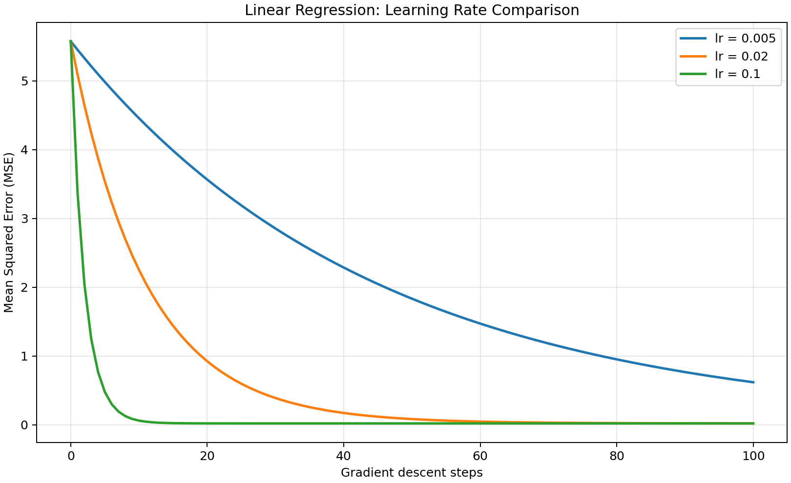

# Week 01 · 线性回归基础实验

使用 NumPy 手工实现一元线性回归与批量梯度下降，学习记录训练损失、绘制曲线，并比较不同学习率对收敛速度和稳定性的影响。

## 学习顺序

| 天数 | 文件 | 学习内容 |
| --- | --- | --- |
| Day 01 | [NumPy 基础](day01_numpy.py) | 练习数组、形状、切片和矩阵运算。 |
| Day 02 | [手写线性回归](day02_linear_regression.py) | 实现均方误差（MSE）和梯度下降。 |
| Day 03 | [用模拟数据训练](day03_numpy_linear_regression.py) | 从带噪声的数据中估计线性模型的参数。 |
| Day 04 | [绘制损失曲线](day04_loss_visualization.py) | 比较学习率，生成图表与 CSV。 |
| Day 05 | [实验报告](day05_experiment_record.md) | 记录实验设置、结果、分析和问题排查。 |

第 4 天的图表和数据保存在 [`outputs_day04/`](outputs_day04/)，主线实验的依赖见 [`requirements.txt`](requirements.txt)。

## 环境与运行

推荐在 WSL Ubuntu 的 Python 虚拟环境中运行：

```bash
cd ~/ai-study
source .venv/bin/activate
python -m pip install -r stage1/week01/requirements.txt
python stage1/week01/day04_loss_visualization.py
```

复现时使用相同随机种子 42、样本数 100、初始 `w=b=0`，更新 100 次，比较 `lr=0.005, 0.02, 0.1`，并使用 `lr=1.0` 测试发散。

## 结果展示



训练记录与解释见 [第 5 天实验报告](day05_experiment_record.md)。

## 补充：交互绘图示例

[`interactive_demo/train.py`](interactive_demo/train.py) 是单独的学习率对比示例，目录里也保留了[已有的曲线图](interactive_demo/loss_curve.png)。脚本使用 Matplotlib 的 `QtAgg` 后端弹窗，需要安装 Qt 绑定（如 PySide6）。在仓库根目录激活虚拟环境后可运行：

```bash
python stage1/week01/interactive_demo/train.py
```

## 已知局限

这是使用人工生成数据的教学实验，仅比较训练集 MSE；尚未引入独立验证集、多次随机种子重复实验或统计显著性分析。
