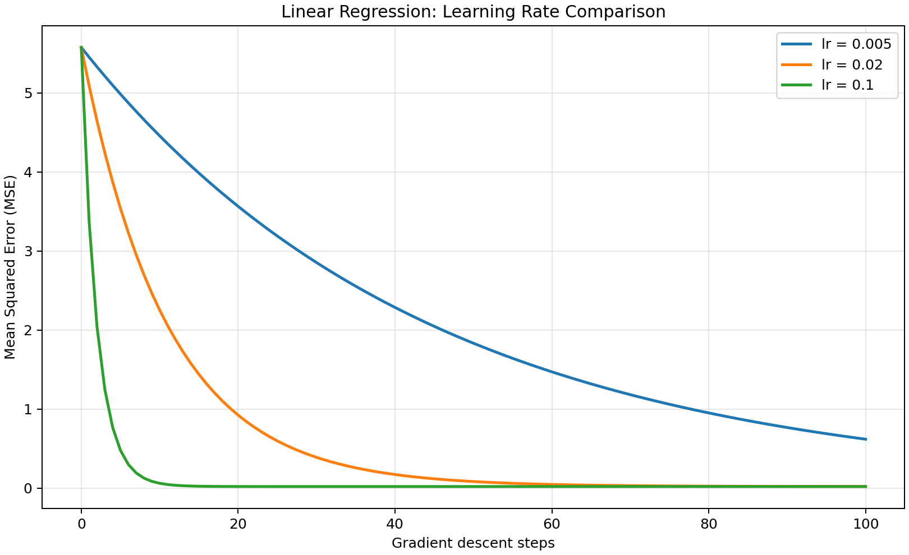
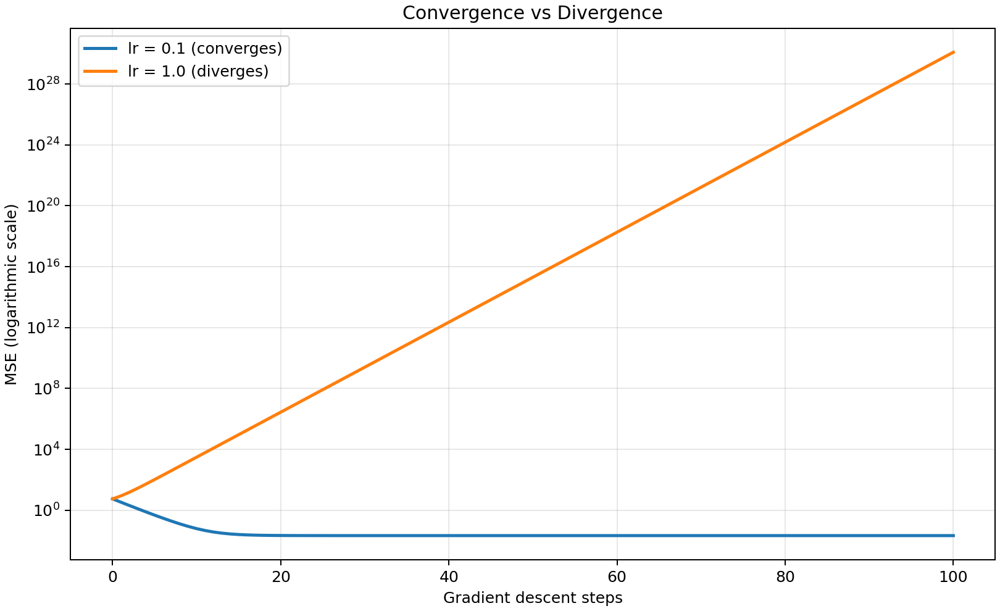
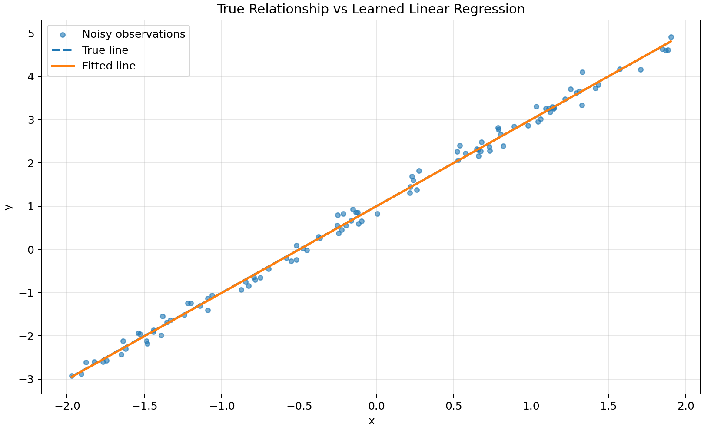

# 实验 001：线性回归中学习率对梯度下降收敛的影响

> 项目：ai-study / 阶段 1 / Week 01  
> 记录日期：2026-11-08（可改为自己的实际实验日期）  
> 状态：基于第 3～4 天的示例代码与已生成的实验数据整理；正式提交前请在本机重新运行核对。

## 1. 实验目的

使用 NumPy 从零实现一元线性回归，比较不同学习率对批量梯度下降收敛速度和稳定性的影响；学习记录 Loss 历史、生成对比曲线、保存可复现实验资料。

## 2. 实验假设

在相同数据、初始化和训练轮数下，合理增大学习率可能加快收敛；当学习率超出稳定范围时，参数更新可能越过最优区域并导致损失发散。

## 3. 实验方法

数据由以下规律生成：

`y = 2*x + 1 + noise`

其中 `x` 在 `[-2, 2)` 上均匀采样，`noise` 从均值为 0、标准差为 0.15 的正态分布采样。预测函数为 `y_pred = w*x + b`；损失函数使用 `MSE = mean((y_pred-y)**2)`。分别手动计算 `dw = 2*mean((y_pred-y)*x)` 和 `db = 2*mean(y_pred-y)`，随后使用 `w -= lr*dw`、`b -= lr*db` 更新参数。

每组实验重新初始化 `w=b=0`，固定同一份数据和训练轮数，仅改变学习率。`losses[0]` 表示训练开始前的损失，`losses[t]` 表示完成第 `t` 次更新后的损失。

## 4. 实验参数

| 项目 | 设置 |
|---|---|
| 数据规模 | 100 个样本 |
| 随机种子 | 42 (`np.random.default_rng(42)`) |
| 真实模型 | `y=2*x+1+noise` |
| 输入分布 | `Uniform(-2, 2)` |
| 噪声分布 | `Normal(0, 0.15)`（第二个参数为标准差） |
| 初始参数 | `w=0.0, b=0.0` |
| 优化方法 | 全批量梯度下降，手动求梯度 |
| 损失函数 | 均方误差 MSE |
| 更新次数 | 100 |
| 主要学习率 | `0.005, 0.02, 0.1` |
| 发散验证 | `1.0` |
| Python 版本 | **待补充：** `python --version` |
| NumPy 版本 | **待补充：** `python -c "import numpy; print(numpy.__version__)"` |
| Matplotlib 版本 | **待补充：** `python -c "import matplotlib; print(matplotlib.__version__)"` |
| 运行环境 | WSL Ubuntu + VS Code + 项目 `.venv`（核对后修改） |

## 5. 实验结果

在配套 `day04_loss_visualization.py` 的已生成数据中，初始 MSE 为 **5.573868**。更新 100 次后：

| 学习率 | 最终 MSE | 观察 |
|---|---:|---|
| 0.005 | 0.619954 | 损失持续下降，但在 100 次内下降较慢 |
| 0.02 | 0.022437 | 已接近稳定值 |
| 0.1 | 0.021574 | 更快达到稳定区间 |
| 1.0 | 约 1.22×10³⁰ | 损失迅速增大，出现发散 |

### 5.1 不同学习率的损失曲线



### 5.2 收敛与发散对比（对数纵轴）



### 5.3 真实直线与模型拟合结果



全部轮次的原始损失见 [`outputs_day04/loss_history.csv`](outputs_day04/loss_history.csv)。

## 6. 结果分析

在本次固定的带噪声线性回归数据上，学习率 0.005 较小，每轮参数更新幅度有限，100 次更新后仍未充分收敛；学习率 0.02 和 0.1 能够更快降低训练损失。学习率为 1.0 时，更新幅度超过本实验的稳定范围，参数在最优区域两侧越过且偏差增大，导致 Loss 发散。

数据中存在随机噪声，因此即便模型已经基本收敛，训练 MSE 也不要求为 0。上述结果不代表所有数据集的最佳学习率都是 0.1；输入尺度、损失函数的曲率以及初始化都会改变合适的学习率范围。

本实验只评估了训练数据，不能据此直接证明模型对新样本的泛化能力。后续可增加训练集 / 验证集拆分、不同随机种子重复实验等内容。

## 7. 遇到的问题与排查

1. **安装 Matplotlib 时网络超时。** 安装过程中出现 `Connection timed out` / `incomplete-download`；通过调整超时与镜像源等方式完成安装。实际采用的命令：**待补充**。
2. **`plt.show()` 不弹出窗口。** 检查发现当前后端为 `agg`，`DISPLAY=:0`，环境中缺少 Tkinter。之后安装 PySide6 并启用 QtAgg，图像能够正常显示。
3. **绘图与实验记录一致性。** 统一在每次更新后计算并追加 Loss，保留第 0 次的初始 Loss，因此 100 次更新共记录 101 个数据点。

## 8. 复现方法

在 `ai-study` 仓库根目录执行：

```bash
source .venv/bin/activate
python -m pip install numpy matplotlib
python stage1/week01/day04_loss_visualization.py
```

如果是在一台新电脑上，应先创建虚拟环境，再安装依赖。该脚本将相对于脚本位置生成 `outputs_day04/`，含三张 PNG 图片与一份 CSV 数据文件。

## 9. 本次结论及下一步

**结论：** 合理设置学习率能在本实验中加快梯度下降收敛；学习率过大可能导致损失发散。绘制 Loss 曲线比只观察最终数值更容易发现收敛速度和数值不稳定的问题。

**下一步：** 引入训练集 / 验证集，比较训练误差与泛化误差；尝试不同随机种子并总结实验结果的稳定性。

---

> 研究记录原则：真实运行结果与分析分开写；环境、种子、超参数都明确记录；结论只覆盖本次实验所支持的范围。
